# CRM Pro · Frontend

[](https://github.com/jessicaccl/crm-frontend/actions/workflows/ci.yml)

Interface do CRM de vendas: clientes, funil Kanban, painel de resultados e integrações.
API em [crm-vendas-backend](https://github.com/jessicaccl/crm-vendas-backend).

**Demo online:** https://crm-pro-jessica.vercel.app (clique em "Entrar como demo")
*(plano gratuito: o primeiro acesso pode levar até 1 minuto enquanto o servidor acorda)*

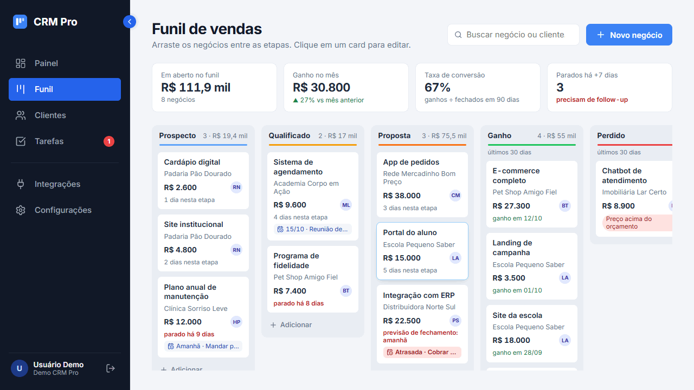

**Stack:** React 19 · TypeScript · Vite · React Router · TanStack Query · dnd-kit · React Hook Form + Zod · Sonner · Lucide

## Telas

| Funil de vendas | Motivo da perda |
|---|---|
| 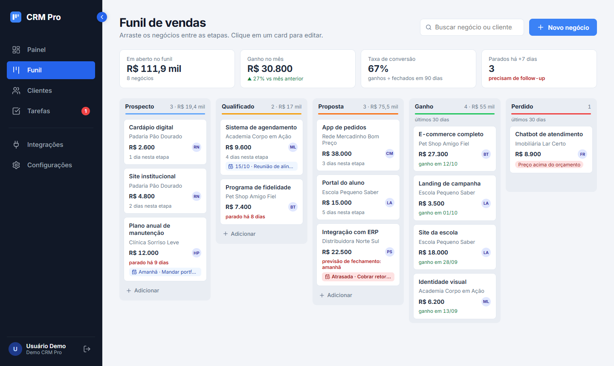 | 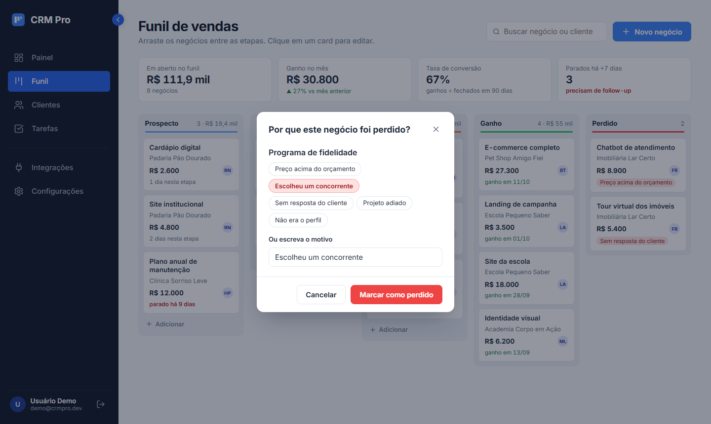 |

| Login | Editar negócio |
|---|---|
| 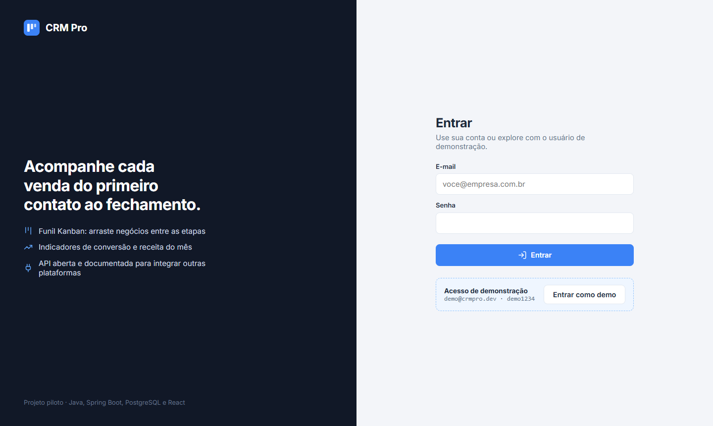 | 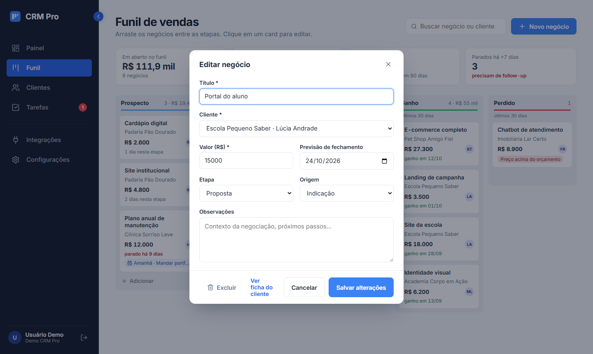 |

**Multiempresa:** a mesma tela, vista por duas organizações diferentes.

| Unic Studio (dados reais) | Demo (dados fictícios) |
|---|---|
| 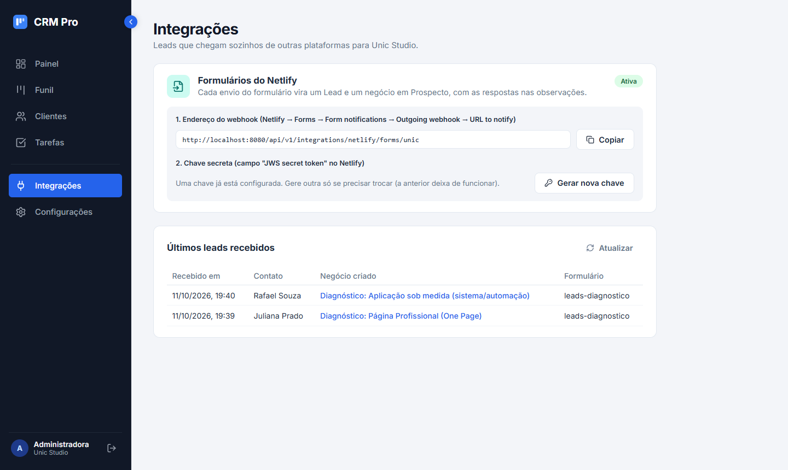 | 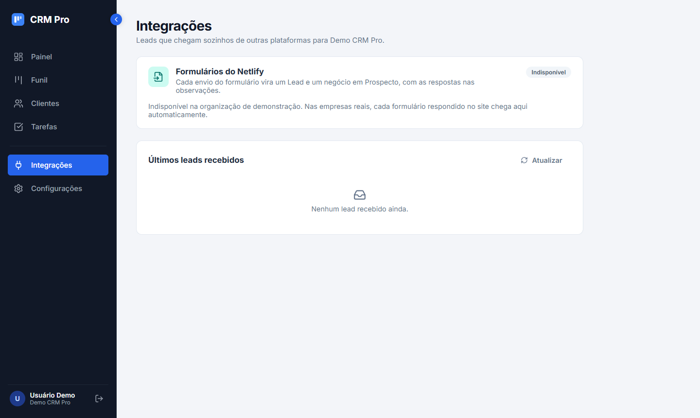 |

| Funil da Unic (só os leads dela) | Lead do quiz no funil |
|---|---|
| 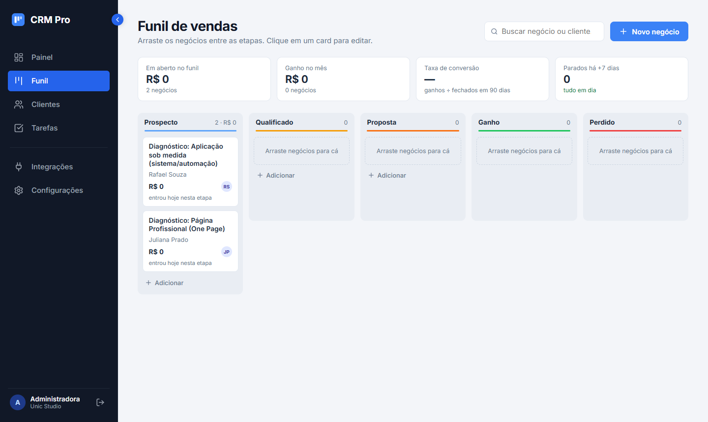 | 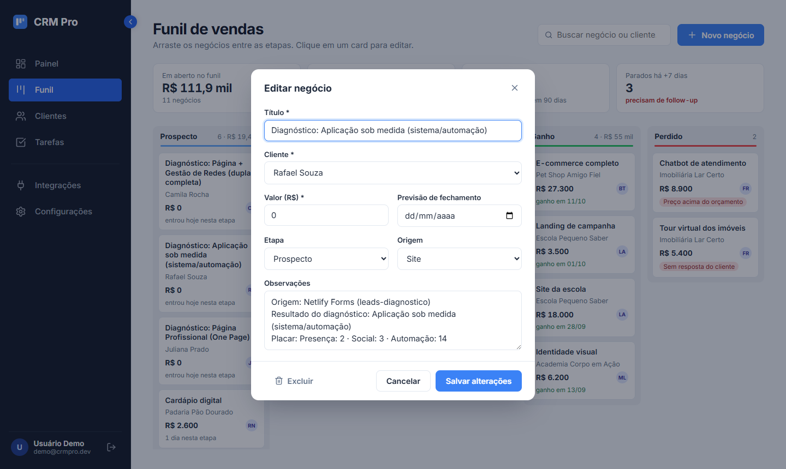 |

| Clientes | Celular |
|---|---|
| 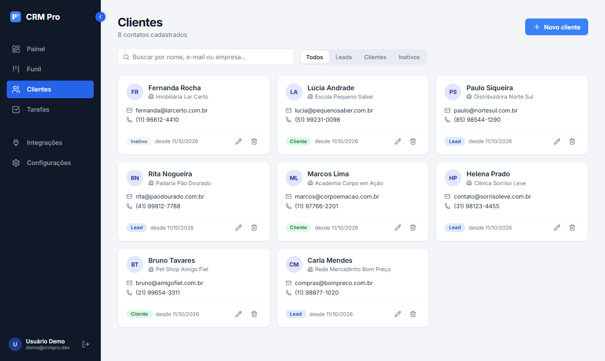 | 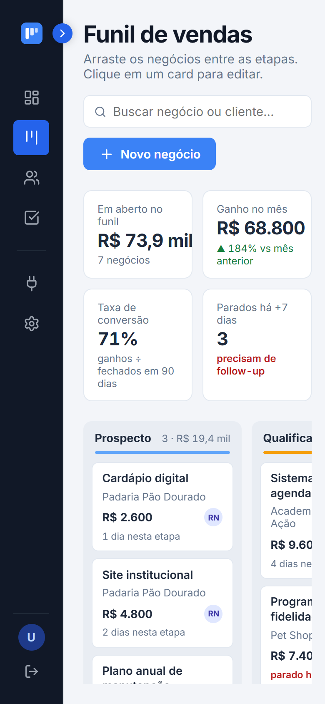 |

## O que já funciona

- **Login** com token JWT, acesso de demonstração em um clique e aviso quando o servidor gratuito está "acordando"
- Sessão expirada leva de volta ao login, sem perder a página que você tentou abrir
- **Funil Kanban**: arrastar e soltar negócios entre Prospecto, Qualificado, Proposta, Ganho e Perdido (mouse, toque e teclado)
- Atualização otimista: o card muda na hora e volta sozinho se a API recusar
- Ao soltar em "Perdido", o sistema pede o motivo da perda
- Indicadores no topo: valor em aberto, ganho no mês vs mês anterior, taxa de conversão e negócios parados
- Cards sinalizam negócios parados há 7+ dias e previsões de fechamento vencendo
- Cadastro, edição e exclusão de negócios
- Lista de clientes com busca, filtro por status (Lead, Cliente, Inativo) e paginação
- Cadastro e edição em modal, com validação no navegador e mensagens de erro vindas da API
- **Multiempresa**: cada pessoa vê só os dados da própria organização; o nome da empresa aparece no menu
- **Integrações**: endereço do webhook da organização, geração da chave secreta (mostrada uma vez) e últimos leads recebidos do quiz
- Observações em cada negócio (os leads do quiz chegam com o resultado e o placar)
- Estados de carregando, erro e lista vazia
- Menu lateral recolhível e layout que funciona no celular

## Como rodar

Com a API rodando em `http://localhost:8080`:

```bash
npm install
cp .env.example .env.local   # opcional: só se a API estiver em outro endereço
npm run dev
```

Abra http://localhost:5173 e clique em **Entrar como demo** (`demo@crmpro.dev` / `demo1234`).

## Deploy na Vercel

1. Em [vercel.com](https://vercel.com): Add New → Project → importe este repositório (o Vite é detectado sozinho).
2. Em Environment Variables, defina `VITE_API_URL` com o endereço da API no Render, terminando em `/api/v1`.
3. Deploy. O `vercel.json` faz as rotas do React (ex.: `/funil`) funcionarem ao recarregar a página.

| Variável | Para quê |
|---|---|
| `VITE_API_URL` | endereço da API, terminando em `/api/v1` |
| `VITE_DEMO_MODE` | `false` no ambiente real: esconde o acesso de demonstração da tela de login |

Guia completo com prints (banco, API e frontend): [DEPLOY.md no repositório do backend](https://github.com/jessicaccl/crm-vendas-backend/blob/main/docs/DEPLOY.md).

## Estrutura

```
src/
  components/   Button, Modal, Sidebar, KpiStrip, DealCard, DealFormModal, LostReasonModal, CustomerCard...
  context/      sessão do usuário (AuthProvider)
  pages/        Pipeline (funil), Customers, Login, Settings e páginas das próximas fases
  hooks/        useDeals (com atualização otimista ao arrastar), useCustomers, useDebouncedValue
  utils/        formatação de moeda e datas
  services/     cliente HTTP (axios), token e leitura de erros da API
  types/        tipos compartilhados com o contrato da API
```

## Roteiro

- [x] Fase 1: base (rotas, CRUD de clientes, validação, estados de tela)
- [x] Fase 2: funil Kanban com arrastar e soltar e indicadores
- [x] Fase 3: login, CI, deploy e demo online
- [x] Fase 4: tela de Integrações (leads do quiz via Netlify)
- [x] Fase 5: multiempresa (organização no menu, chave do webhook por empresa)
- [ ] Fase 6: painel de resultados com gráficos
- [ ] Fase 7: ficha do cliente com atividades e tarefas
