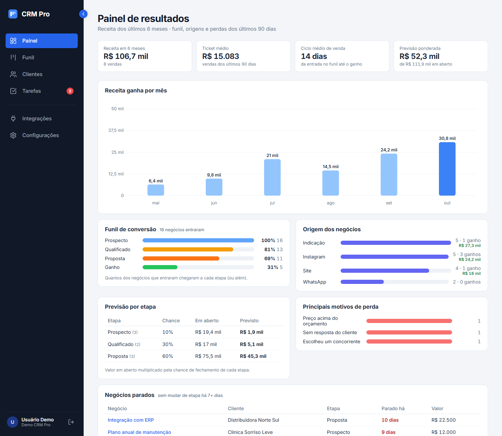
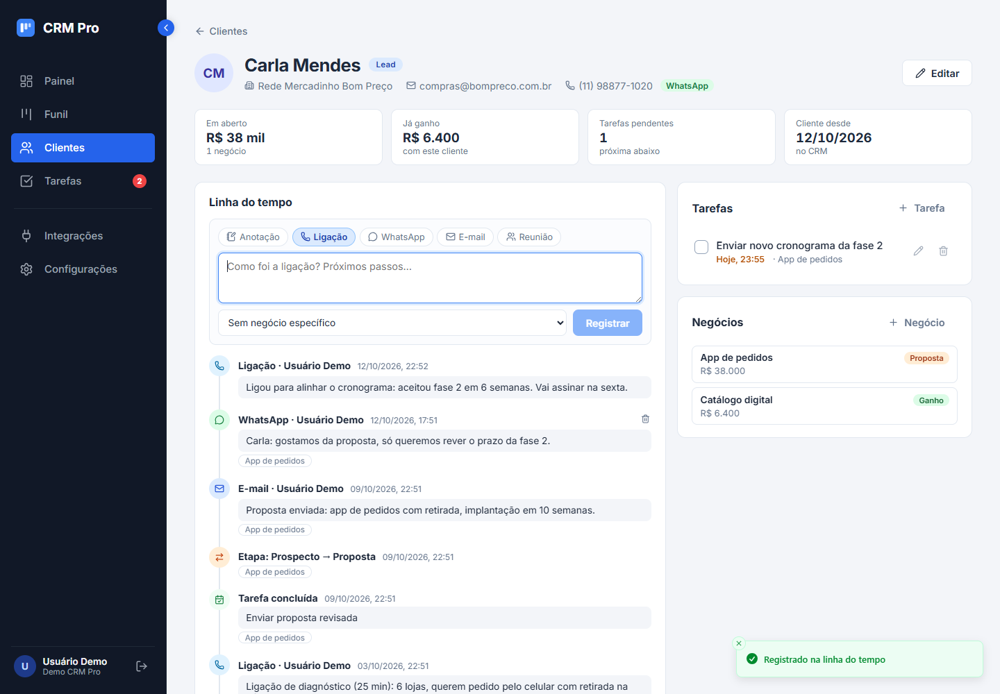
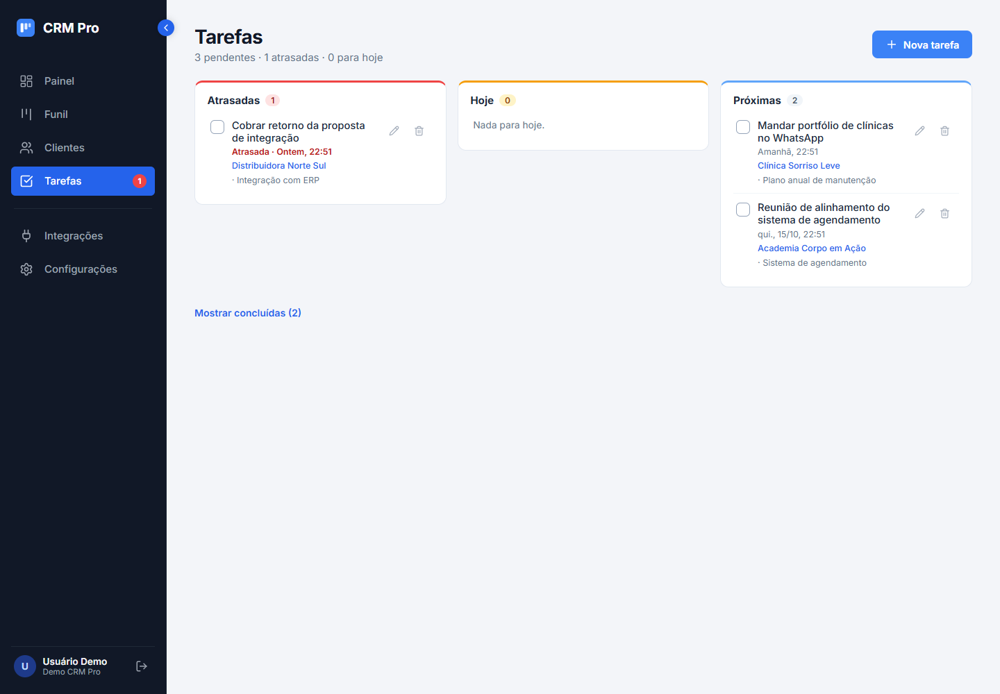
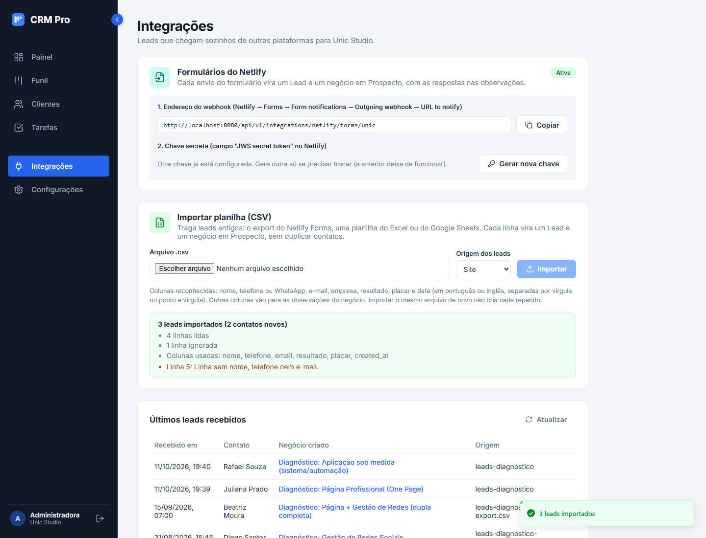

# CRM Pro · Frontend

[](https://github.com/jessicaccl/crm-frontend/actions/workflows/ci.yml)

CRM de vendas multiempresa para pequenos negócios: funil Kanban, ficha do cliente com histórico e tarefas,
painel de resultados e leads entrando sozinhos a partir do site.
API em [crm-vendas-backend](https://github.com/jessicaccl/crm-vendas-backend).

**Demo online:** https://crm-pro-jessica.vercel.app (clique em "Entrar como demo")


**Stack:** React 19 · TypeScript · Vite · React Router · TanStack Query · dnd-kit · React Hook Form + Zod · Sonner · Lucide

## Telas

| Funil de vendas | Painel de resultados |
|---|---|
|  |  |

| Ficha do cliente | Tarefas |
|---|---|
|  |  |

| Motivo da perda | Editar negócio |
|---|---|
|  |  |

**Multiempresa:** a mesma tela vista por duas organizações diferentes.

| Unic Studio (dados reais) | Demo (dados fictícios) |
|---|---|
|  |  |

| Lead do quiz no funil | Importação de planilha |
|---|---|
|  |  |

| Login | Celular |
|---|---|
|  |  |

## Funcionalidades

**Funil e negócios**
- Kanban com arrastar e soltar (mouse, toque e teclado) e atualização otimista: o card muda na hora e volta se a API recusar
- Ao soltar em "Perdido", o sistema pede o motivo; Ganho e Perdido mostram os últimos 30 dias
- Indicadores no topo: em aberto, ganho no mês vs anterior, conversão e negócios parados
- Cards sinalizam negócio parado, previsão de fechamento vencendo e a próxima tarefa (em vermelho se atrasada)

**Clientes**
- Lista com busca, filtro por status e paginação
- Ficha do cliente: contatos (com atalho para o WhatsApp), negócios, tarefas e **linha do tempo**
  com anotações, ligações, mensagens, mudanças de etapa, leads recebidos e tarefas concluídas

**Tarefas**
- Atrasadas, hoje e próximas; contador no menu; ligadas ao cliente e ao negócio

**Painel de resultados**
- Receita por mês, funil de conversão, origem dos negócios, previsão ponderada por etapa,
  ciclo médio de venda, ticket médio, motivos de perda e negócios parados (gráficos em SVG, sem biblioteca)

**Integrações**
- Webhook do Netlify Forms: endereço e chave secreta por organização, leads recebidos na hora
- Importação de planilha CSV (export do Netlify, Excel, Google Sheets) com relatório do que entrou

**Conta**
- Login com JWT, acesso de demonstração em um clique, aviso quando o servidor gratuito está "acordando"
- Multiempresa: cada pessoa vê só os dados da própria organização
- Layout responsivo; estados de carregando, erro e vazio em todas as telas

## Como rodar

Com a API rodando em `http://localhost:8080`:

```bash
npm install
cp .env.example .env.local   # opcional: só se a API estiver em outro endereço
npm run dev
```

Abra http://localhost:5173 e clique em **Entrar como demo** (`demo@crmpro.dev` / `demo1234`).

## Deploy na Vercel

1. Em [vercel.com](https://vercel.com): Add New → Project → importe este repositório (o Vite é detectado sozinho).
2. Defina `VITE_API_URL` com o endereço da API, terminando em `/api/v1`.
3. Deploy. O `vercel.json` faz as rotas do React (ex.: `/funil`) funcionarem ao recarregar a página.

Guia completo com prints (banco, API e frontend):
[DEPLOY.md no repositório do backend](https://github.com/jessicaccl/crm-vendas-backend/blob/main/docs/DEPLOY.md).

## Estrutura

```
src/
  components/   Sidebar, KpiStrip, DealCard, DealFormModal, TaskFormModal, TaskItem, CsvImportCard...
  context/      sessão do usuário (AuthProvider)
  pages/        Pipeline (funil), Dashboard (painel), Customers, CustomerDetail (ficha),
                Tasks, Integrations, Login, Settings
  hooks/        useDeals (atualização otimista), useTasks, useCustomers, useDebouncedValue
  services/     cliente HTTP (axios), token e leitura de erros da API
  types/        tipos compartilhados com o contrato da API
  utils/        formatação de moeda e datas
```

## Roteiro

- [x] Fase 1: base (rotas, CRUD de clientes, validação, estados de tela)
- [x] Fase 2: funil Kanban com arrastar e soltar e indicadores
- [x] Fase 3: login, CI, deploy e demo online
- [x] Fase 4: leads do quiz via Netlify e importação de planilha
- [x] Fase 5: multiempresa
- [x] Fase 6: painel de resultados
- [x] Fase 7: ficha do cliente, linha do tempo e tarefas
